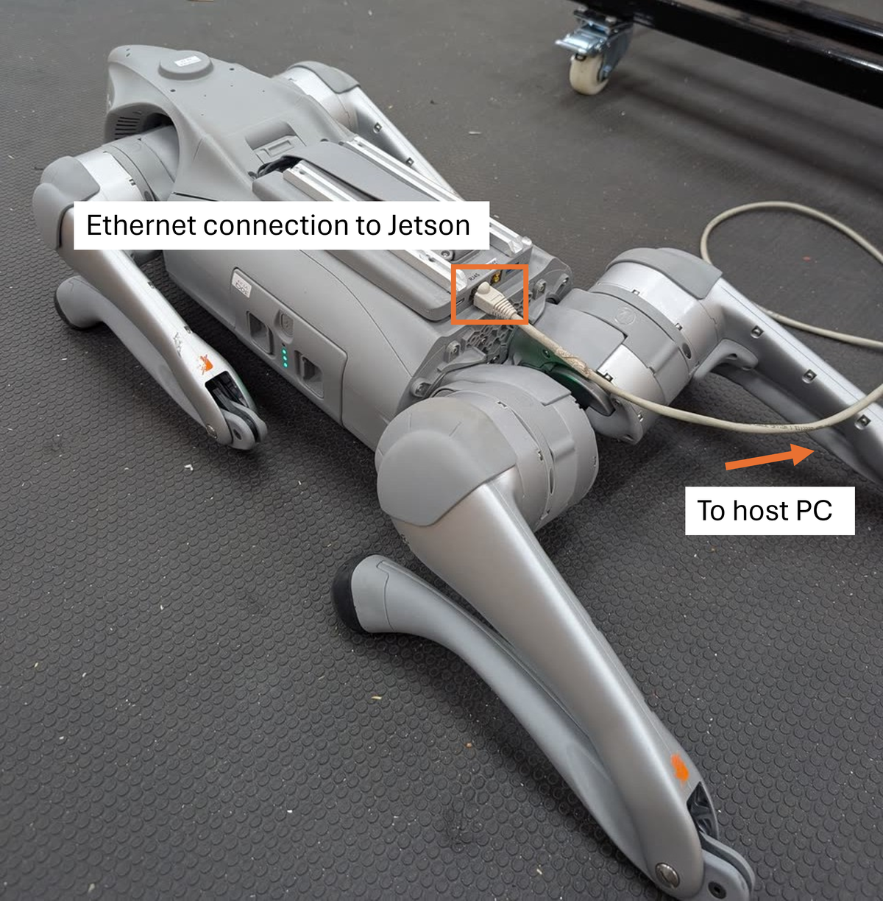
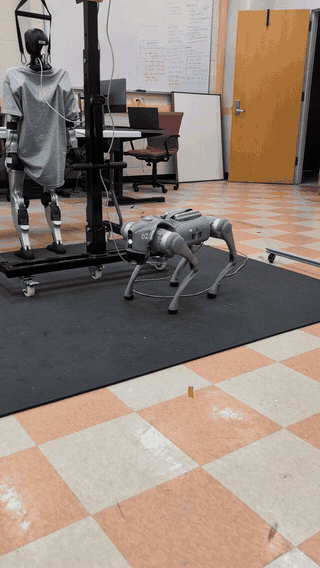

# Go2 ROS: Ethernet to the onboard Jetson

**DyCo-AI Lab · Clemson University · ROS 2 · Python · Windows SSH client**

This starter is primarily for **Windows laptop users who want to SSH into the
Go2 EDU's onboard Jetson and develop/run Unitree SDK and ROS control directly
on that computer**. Windows provides the editor, Git, and SSH client; the Jetson
runs the robot-side Python, ROS, and control software.

The included velocity example uses the **ROS 2 Sport/DDS interface** to request
bounded motion from the Go2's built-in locomotion controller. The
[Unitree SDK2 Python interface](https://github.com/unitreerobotics/unitree_sdk2_python)
is linked below for further SDK-based development; it is not required by this example.

[Setup walkthrough](docs/SETUP.md) · [Identify ROS / JetPack](docs/SOFTWARE.md) ·
[Optional recording](docs/RECORDING.md) · [Source](go2_walk.py)

<p align="center">
  <strong>Ethernet into the Jetson expansion dock</strong><br>
  
</p>

<p align="center">
  <strong>Lab velocity demonstration</strong><br>
  
</p>

## Understand the connection

```text
Windows laptop                          Go2 EDU
PowerShell / SSH client                  Jetson expansion computer
192.168.123.222                          192.168.123.18 (lab address)
       |                                       |
       +----------- Ethernet ------------------+
                                               |
                           SSH shell: unitree@192.168.123.18
                                               |
                              ROS 2 + Python go2_walk.py
                                               |
                              DDS / Sport velocity request
                                               |
                           Go2 onboard locomotion controller
                                               |
                                state feedback + motion
```

`unitree` is the Linux username, not the computer model or a ROS version.
`ssh unitree@192.168.123.18` opens a shell on this lab robot's Jetson. The script
requests high-level motion through the Go2's existing locomotion controller;
it does not replace the leg controller or stand the robot up.

## 1. Clone and connect — Windows PowerShell

```powershell
git clone https://github.com/DyCo-AI/go2-ros.git
Set-Location .\go2-ros
```

Connect Ethernet to the Go2 expansion dock as pictured. Set the Windows
**Ethernet** adapter to `192.168.123.222`, mask `255.255.255.0`, with gateway/DNS
blank. These are lab settings; confirm the assigned address before using another
robot. Keep cable slack clear of the legs and keep the paired remote available.
See [the full walkthrough](docs/SETUP.md) for the Windows settings and robot preparation.

```powershell
Test-NetConnection 192.168.123.18 -Port 22
ssh unitree@192.168.123.18 "mkdir -p /home/unitree/go2_ws/scripts"
scp .\go2_walk.py .\scripts\check_jetson.py unitree@192.168.123.18:/home/unitree/go2_ws/scripts/
ssh unitree@192.168.123.18
```

Get the SSH credential privately from the lab maintainer. After SSH, the commands
you type execute on the Jetson, even though the terminal window is on Windows.
This wired path uses no WebRTC AES key.

## 2. Identify the installed software — Jetson SSH terminal

```bash
cd ~/go2_ws/scripts
python3 check_jetson.py
```

The read-only report identifies the Jetson model, Ubuntu, installed ROS setup
files, the active shell's ROS environment, and installed NVIDIA packages.
**Our existing lab notes use Ubuntu 20.04 + ROS 2 Foxy + CycloneDDS 0.10.2.**
The exact installed JetPack/L4T version has not yet been captured in this starter.
Use [SOFTWARE.md](docs/SOFTWARE.md) to record the actual unit before changing it.

**Foxy is ROS 2; Noetic is ROS 1.** Both may be present in an Ubuntu 20.04 image,
but this script needs ROS 2 and `rclpy`. A Noetic-only shell is insufficient.
Do not source both ROS generations in the same session. A unit with a different
image needs its environment reviewed first; these commands do not install or
upgrade Ubuntu, JetPack, or ROS.

## 3. Load the lab's ROS 2 environment — Jetson SSH terminal

If the inventory confirms the lab's Foxy workspaces:

```bash
source /opt/ros/foxy/setup.bash
source ~/cyclonedds_ws/install/setup.bash
source ~/go2_ws/install/setup.bash
printf 'ROS_VERSION=%s ROS_DISTRO=%s\n' "$ROS_VERSION" "$ROS_DISTRO"
python3 -c "import rclpy; from unitree_go.msg import SportModeState; from unitree_api.msg import Request; print('ROS 2 messages OK')"
python3 go2_walk.py --help
```

Expect `ROS_VERSION=2 ROS_DISTRO=foxy` and a successful message import. Missing
workspaces or message packages are covered in [SETUP.md](docs/SETUP.md).

## 4. Send a short velocity request — Jetson SSH terminal

Proceed only after the normal standing/remote check and instructor approval.
The example requests **0.5 m/s forward for one second at cruise speed**:

```bash
python3 go2_walk.py --vel 0.5 --time 1
```

Default ramps add one second each, and stopping/settling add further time.
`--time` is not total motion duration. Plan clearance for actual travel and cable
movement; measure the response rather than inferring distance from the command.
Run one motion controller at a time, with joystick motion neutral.

Normal finish ramps down, requests zero and StopMove, then requests BalanceStand
only after the script confirms low body speed. Ctrl+C bypasses the ramp and
requests stopping immediately. From another ROS-configured SSH terminal:

```bash
python3 ~/go2_ws/scripts/go2_walk.py --stop
```

Inspect the printed discovery/state/stop result and the actual robot. A published
request is not proof of execution. Software stopping depends on the connection
and process; the instructor retains the paired remote intervention procedure.
The walkthrough describes the known firmware caveats and visual stance check.

## Scope and next steps

- No recording by default. Optional ROS bags are documented in [RECORDING.md](docs/RECORDING.md).
- Default DDS interface: Jetson `eth0`; default state topic: `/lf/sportmodestate`. Verify these on the assigned robot.
- Go2 Sport interface only. This repository is not a Go1 ROS adapter.
- Firmware-specific behavior and a first real bag capture still need a recorded qualification check.
- [Clemson CI simulation labs](https://github.com/sriram-2502/go1-mujoco-playground) and [gesture-navigation reference](https://github.com/sriram-2502/go2-webrtc-gesture-nav) build on the basic robot interfaces; the WebRTC/Wi-Fi path is separate from this SSH/ROS path.

## TODO: Wi-Fi SSH and host-PC RL development

- [ ] **SSH to the Jetson over Wi-Fi:** document the Jetson Wi-Fi interface, network setup, assigned IP, SSH access, and a connection check. The Jetson SSH address must be identified separately from the Go2 WebRTC hotspot endpoint.
- [ ] **Host-PC RL setup:** add a reproducible GPU workstation environment for simulation, policy training, and evaluation, with tested OS/CUDA/framework versions. Document Windows/WSL or Linux requirements for the chosen framework.
- [ ] **Simulation-to-hardware workflow:** document training, policy playback, sim-to-sim checks, export, and transfer to the onboard Jetson.
- [ ] **On-robot policy execution:** add a separate validated runtime and hardware checkout covering observation/action definitions, joint ordering, normalization, control rates, and the required SDK interfaces; update these guidelines with a tested example.

Planned workflow:

```text
Host PC / GPU workstation              Onboard Jetson                 Go2
Train → evaluate → sim-to-sim → export → copy policy → run inference → control
```

The current `go2_walk.py` requests velocity from Unitree's existing locomotion
controller. Learned-policy execution is future work and uses a separate deployment
path. Framework links below are references, not installed dependencies or verified
deployment instructions for this lab robot.

## Useful SDK and robot-learning references

| Resource | What to explore |
| --- | --- |
| [Unitree SDK2 Python](https://github.com/unitreerobotics/unitree_sdk2_python) | Official Python interface for SDK-based control development |
| [RAI Institute — Exploy](https://github.com/rai-opensource/exploy) | Export RL environment/policy logic and deploy with an ONNX Runtime C++ controller; includes Isaac Lab and mjlab integrations |
| [mjlab](https://github.com/mujocolab/mjlab) | MuJoCo-Warp robot-learning framework with an Isaac Lab-style API |
| [Unitree RL mjlab](https://github.com/unitreerobotics/unitree_rl_mjlab) | Unitree's MuJoCo/mjlab training and sim-to-real project, including Go2 examples |
| [Unitree MuJoCo](https://github.com/unitreerobotics/unitree_mujoco) | Official Unitree simulation environment for testing control and deployment workflows |

For Exploy's exporter and controller concepts, see its
[official documentation](https://pages.rai-inst.com/exploy/).

## Development and attribution

Developed by [Sriram Krishnamoorthy](https://github.com/sriram-2502) for the
**DyCo-AI Lab, Clemson University**, to support student onboarding and reusable
robot experiments. This standalone starter preserves the existing Go2 velocity
script from the instructor setup; its motion behavior is unchanged.
See [NOTICE.md](NOTICE.md) for sources and media, and [CONTRIBUTING.md](CONTRIBUTING.md)
for maintenance. Released under the [MIT License](LICENSE).
