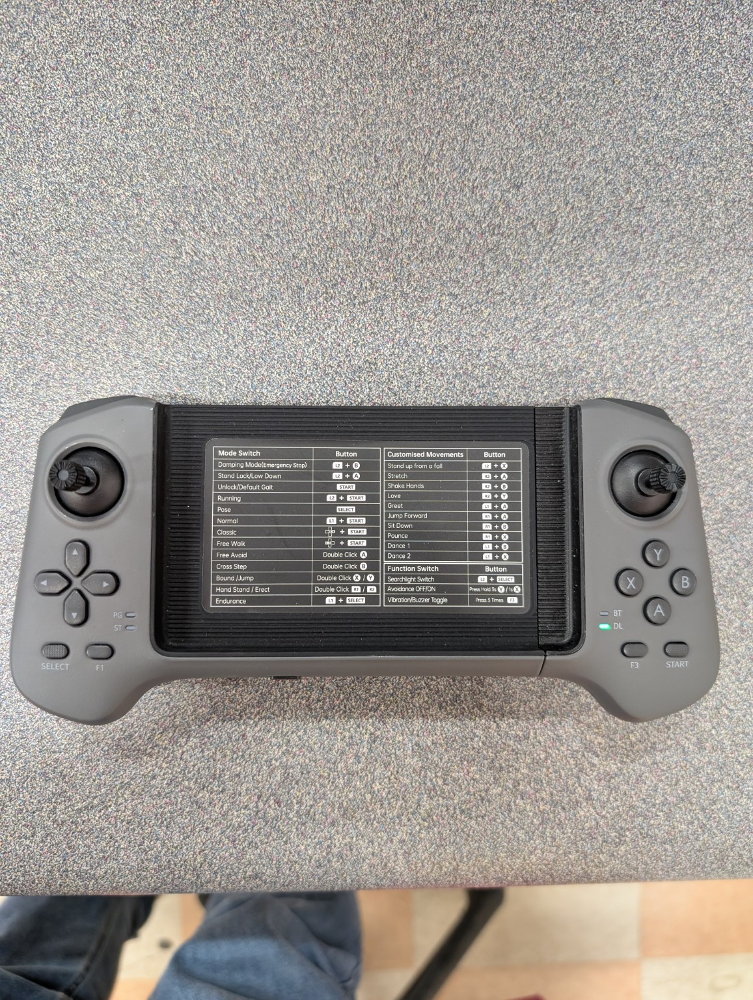
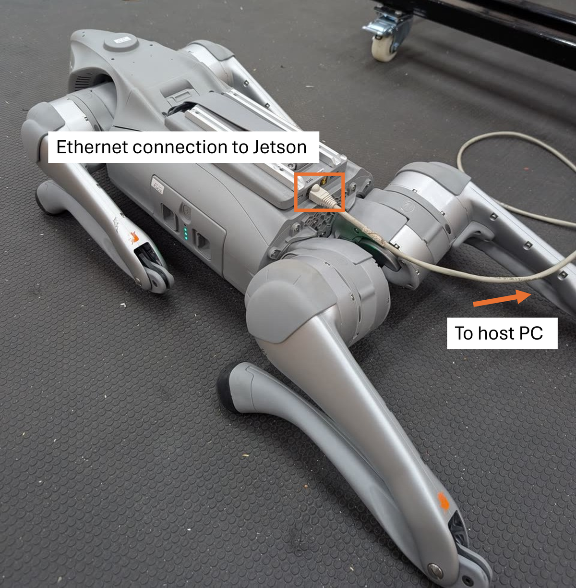

# ROS 2 + Ethernet: Go2 research setup

For research and PhD students in our Clemson lab. Return to the
[starter overview](../README.md). This repository covers Ethernet/SSH/ROS only.

This guide takes you from a powered-off Go2 EDU to a walking command entered
from a Windows laptop. It also explains the optional rosbag recording modes.

**The script runs on the robot's Jetson through SSH. Windows does not need ROS.**
By default, the script does not record data.

## What you need

- Go2 EDU with the Jetson Orin NX expansion computer and a charged battery.
- The robot's paired remote or Unitree Go phone app.
- A Windows laptop, an Ethernet cable, and a USB-to-Ethernet adapter if needed.
- A clone or extracted copy of this repository, including `go2_walk.py` and `scripts/check_jetson.py`.

This guide uses the robot configuration established for this project:

| Item | Setting |
| --- | --- |
| Jetson IP | `192.168.123.18` |
| Windows Ethernet IP | `192.168.123.222` |
| Subnet mask | `255.255.255.0` |
| SSH user | `unitree` |
| SSH password | Obtain the current credential from the lab maintainer |
| Jetson interface to the robot | `eth0` |
| Jetson software | Ubuntu 20.04, ROS 2 Foxy, CycloneDDS 0.10.2 |

First run the [read-only software report](SOFTWARE.md) to identify this unit.
The version table above is the previously documented lab baseline, not a new
inventory capture. JetPack/L4T is still to be recorded. Noetic is ROS 1 and cannot
run this ROS 2 script. Foxy and the CycloneDDS workspace must already exist on the Jetson. The optional
setup section at the end explains how to add the Unitree message packages if
this robot does not have them built yet.

## 1. Power on, stand up, and test the joystick

1. Put the robot on a level, nonslip floor with clear space around it.
2. Power on the robot using its normal battery power-button procedure and wait
   for startup to finish.
3. Use the paired remote or Unitree Go app to make the robot stand normally.
4. **If it is standing but the joystick does not move it, press START once.**
   This is the unlock/default-gait button. Then try the joystick again.
5. **For these clear-floor velocity tests, press and hold Y for 3 seconds to
   turn obstacle avoidance off.** Keep the travel area clear: obstacle avoidance
   will no longer intervene for these tests.
6. Briefly test joystick walking, then release the joystick and let it stop.

### Find START and Y on this controller



*Photo: the controller supplied for this project. These instructions apply to
this two-stick handheld controller.*

| What you need | Button location in the photo | Action |
| --- | --- | --- |
| Standing, but joystick walking is locked | **START**: bottom-right oval button, to the right of F3 | **Press once**, then test the joystick |
| Disable obstacle avoidance for the open-floor test | **Y**: top button in the right-hand four-button cluster | **Press and hold Y for 3 seconds**, then release |
| Re-enable obstacle avoidance after testing | **X**: left button in that same four-button cluster | **Press X once** |

Use Y on its own for the avoidance-off action. The controller's center reference
sticker also lists START as Unlock/Default Gait and Y held for 3 seconds as
Avoidance OFF. See the [Unitree handheld-controller manual](https://marketing.unitree.com/article/en/Go2/Handheld_Remote_Control.html)
for the full button reference.

If normal joystick standing or walking still does not work, resolve that first.
Keep the built-in Unitree motion service running. The script uses that service
for walking; it does not provide its own leg controller or stand the robot up.
Obstacle avoidance is changed manually on the controller, not by the script.

## 2. Connect Ethernet



The cable and SSH connection access the **onboard Jetson expansion computer**.
`unitree` is the Linux account name; the ROS node runs on that computer.


Connect the laptop to the Go2 EDU's external user Ethernet port. A
USB-to-Ethernet adapter is fine if your laptop has no Ethernet socket.

Keep enough cable slack for the intended travel, and keep the cable away from
all four legs. The robot hotspot is not needed for this wired setup. The laptop
can keep its Wi-Fi connected to your normal internet network.

## 3. Set the Windows Ethernet address

On Windows:

1. Press **Win+R**, type `ncpa.cpl`, and press Enter.
2. Right-click the connected **Ethernet** adapter and choose **Properties**.
3. Select **Internet Protocol Version 4 (TCP/IPv4)** and click **Properties**.
4. Select **Use the following IP address** and enter:

| Field | Value |
| --- | --- |
| IP address | `192.168.123.222` |
| Subnet mask | `255.255.255.0` |
| Default gateway | Leave blank |
| DNS servers | Leave blank |

Click OK to save. Change the **Ethernet adapter only**, not the Wi-Fi adapter.
If you later use that Ethernet adapter on a normal network, restore automatic
IP/DNS settings as appropriate for that network.

## 4. Check the connection from Windows

Open **Windows PowerShell** and run:

```powershell
Test-NetConnection 192.168.123.18 -Port 22
```

Look for:

```text
TcpTestSucceeded : True
```

If it is False, check the cable, robot/Jetson power, active Ethernet adapter,
and static IP settings before continuing.

## 5. Copy the scripts to the Jetson

From this repository's root in **Windows PowerShell**:

```powershell
ssh unitree@192.168.123.18 "mkdir -p /home/unitree/go2_ws/scripts"
scp .\go2_walk.py .\scripts\check_jetson.py unitree@192.168.123.18:/home/unitree/go2_ws/scripts/
```

Obtain the SSH password privately. Confirm the robot address/host key on first
connection. This copies scripts; it does not copy or remove past recordings.
The setup documentation can be read in your Windows checkout or on GitHub.

## 6. SSH into the Jetson and load ROS

In **Windows PowerShell**:

```powershell
ssh unitree@192.168.123.18
```

Your prompt should now look similar to:

```text
unitree@ubuntu:~$
```

You are now typing commands on the Jetson. In this **SSH terminal**, run:

```bash
cd ~/go2_ws/scripts
python3 check_jetson.py
# Continue only after confirming the Foxy environment described below.
source /opt/ros/foxy/setup.bash
source ~/cyclonedds_ws/install/setup.bash
source ~/go2_ws/install/setup.bash
```

Repeat these setup commands whenever you open a new SSH session. The script
sets its own DDS interface and ROS domain; no additional exports are needed
for running it.

Check the file without moving the robot:

```bash
python3 -m py_compile go2_walk.py
python3 go2_walk.py --help
```

The syntax check prints nothing on success. No `colcon build` is needed after
copying or editing the Python script.

## 7. Run a short walking test

Start with `--vel 0.5 --time 1` for the first instructor-approved checkout.
The longer examples below require additional clear space.


The robot must already be standing. Keep the remote ready, leave the joystick
neutral, and allow clear space and cable slack for the motion.

In the **SSH terminal**:

```bash
python3 go2_walk.py --vel 0.5 --time 2
```

This requests forward walking at **0.5 m/s for two cruise seconds**. There is a
three-second countdown, a one-second acceleration ramp, and a one-second
normal deceleration ramp. Allow roughly 1.5 m of requested travel plus margin;
actual movement depends on the robot's tracking and stopping behavior.

At the end, the script sends zero velocity, requests StopMove, and requests
BalanceStand only after confirming a successful stop reply, low reported body
speed, and upright reported height. Check that all four feet settle on the floor.

For a longer run, after the short test works:

```bash
python3 go2_walk.py --vel 0.5 --time 5
```

**`--time` is time at cruise speed, not total run time.** Ramps and stopping
add time and travel. At 0.5 m/s with five cruise seconds and default ramps,
the nominal requested travel is about 3 m, plus actual stopping behavior.

Run one walking program at a time. Do not send joystick motion commands at
the same time as scripted walking.

## 8. Stop the robot

**Ctrl+C** in the running script requests immediate stopping instead of the
normal ramp down. The remote remains the independent way to intervene.

From another ROS-configured SSH terminal, a stop-only command is:

```bash
python3 ~/go2_ws/scripts/go2_walk.py --stop
```

It sends no nonzero velocity and then conditionally requests BalanceStand.
Stop-only commands bypass recording startup, even if a recording flag is given.
The stop and stance sequence within a recorded walking run is still recorded.

Software stopping depends on communication and the process remaining alive.
It cannot guarantee stopping after power loss, SIGKILL, or communication failure.
The current contact fields do not confirm all four feet are down; check visually.

## 9–10. Optional recording and data inspection

See [RECORDING.md](RECORDING.md). Recording is off by default. Keep full bags
and run metadata outside Git.

## 11. Other script arguments

| Argument | Default | Meaning |
| --- | --- | --- |
| `--vel` / `--vx` | `0.5` | Forward speed, magnitude 0.5–1.0 m/s; negative means backward |
| `--vy` | `0` | Lateral speed, within ±0.2 m/s |
| `--yaw-rate` | `0` | Turning speed, within ±0.5 rad/s |
| `--time` / `--duration` | `5` | Cruise duration, greater than zero and at most 30 s |
| `--ramp-up` | `1` | Acceleration duration, 0.2–3 s |
| `--ramp-down` | `1` | Normal deceleration duration, 0.2–3 s |
| `--interface` | `eth0` | Jetson interface connected to the robot |
| `--state-topic` | `/lf/sportmodestate` | Body-state feedback topic |
| `--log-dir` | `~/go2_ws/logs` | Recording parent directory |

The 0.5 m/s minimum is this project's chosen cruise-speed setting. Ramps pass
through lower speeds. Lateral/turning commands accompany forward/backward
walking; lateral-only motion is not implemented. The script keeps the current
walking gait and does not automatically stand up, disable motion services,
or command damping.

## 12. If the Unitree message packages are missing

Skip this section on the robot where `unitree_go` and `unitree_api` were already
built successfully. It assumes Foxy and `~/cyclonedds_ws/install/setup.bash`
already exist. A fresh Jetson OS needs those prerequisites installed separately.

In the **SSH terminal**, after sourcing Foxy and CycloneDDS:

```bash
ros2 pkg prefix unitree_go
ros2 pkg prefix unitree_api
```

If they are missing and the source is not already in `~/go2_ws/src`, download
this ZIP using your Windows browser:

[Download Unitree ROS 2 ZIP](https://github.com/unitreerobotics/unitree_ros2/archive/refs/heads/master.zip)

Copy it in **Windows PowerShell**:

```powershell
scp "$env:USERPROFILE\Downloads\unitree_ros2-master.zip" unitree@192.168.123.18:/home/unitree/
```

In the **SSH terminal**:

```bash
mkdir -p ~/go2_ws/src
python3 -m zipfile -e ~/unitree_ros2-master.zip ~/go2_ws/src/
source /opt/ros/foxy/setup.bash
source ~/cyclonedds_ws/install/setup.bash
cd ~/go2_ws
colcon list
colcon build --packages-select unitree_go unitree_api --parallel-workers 2
source ~/go2_ws/install/setup.bash
python3 -c "from unitree_go.msg import SportModeState; from unitree_api.msg import Request; print('Messages OK')"
```

Do not add a second copy if the sources already exist. The ZIP transfer does
not require internet on the robot. If a build dependency is missing, install
that dependency before continuing; copying source alone does not supply it.

## 13. Troubleshooting and later visualization

| Problem | What to check |
| --- | --- |
| Standing robot does not respond to joystick | Press **START once** to unlock/default gait, then test again |
| Robot stops or refuses forward motion near objects | For the clear-floor test, hold **Y for 3 seconds** to turn avoidance off; keep the path clear |
| Cannot SSH | Robot/Jetson power, Ethernet cable, Windows Ethernet address, port-22 test |
| `rclpy` or `unitree_go` import fails | Source the three ROS setup files in the current SSH terminal |
| No Sport subscriber/state | Check `eth0`, the robot's normal motion service, and network connection |
| Recorder fails or times out | Read `recorder.log`; check `ros2 bag record --help` and available disk space |
| Recorded run has missing data | Inspect topic message counts, publisher activity, message types, and QoS |
| Stance is not confirmed | Use the remote and check all four feet before another walking test |
| `error_code: 100` appears | Its firmware-specific meaning remains unverified; it was present during both joystick and scripted walking |

Recording startup requires 512 MiB free; a recorded walk is stopped if free
space drops below 256 MiB. Signal handling and normal shutdown are best effort,
not a hardware emergency-stop mechanism.

Foxglove on Windows is a later viewing step. These recordings use Foxy's native
SQLite ROS bag format. MCAP is a useful later export with embedded message
schemas; conversion is not included here. CSV can be exported for selected
signals, with explicit flattening and time alignment.

Animating the Go2 model additionally needs URDF/meshes and joint-state/transform
publishers. Requesting those topics in a bag does not create them. Do not run
`ros2 bag play` on command-inclusive recordings while connected to the live
robot: playback republishes the recorded movement commands.

The basic walking and stance sequence were exercised on this robot. Recording
lifecycle and option selection have been tested with simulated interfaces;
actual bag capture still needs a first check on the Jetson.
